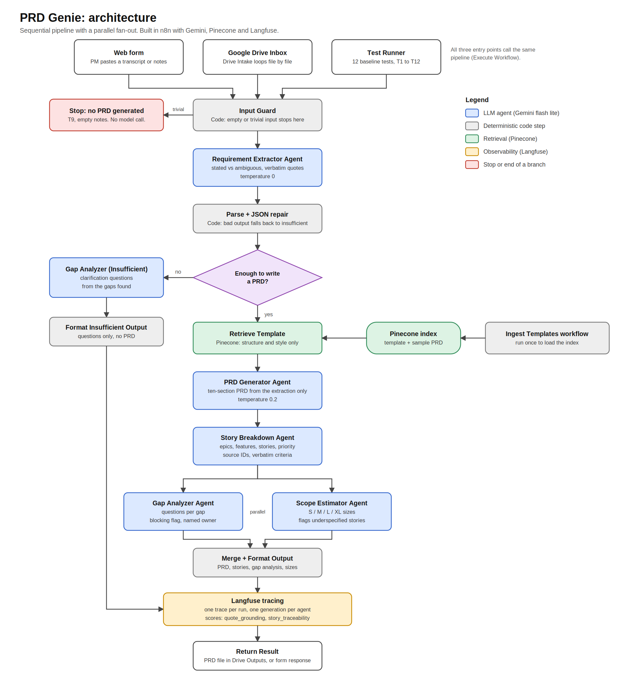

# PRD Genie: AI-Powered Product Documentation Assistant

PRD Genie reads meeting transcripts, product briefs, and stakeholder notes, then produces a structured PRD, Epics / Features / User Stories with priorities, a gap analysis with clarification questions, and T-shirt size estimates. It is built in n8n with Google Gemini, Pinecone, and Langfuse, as the capstone for *Applied Agentic AI for PMs/TPMs* (NeuronForge Technologies scenario).

The design rule throughout: **every requirement must trace back to the input.** Where the input is vague, incomplete, or contradictory, PRD Genie says so and asks questions. It does not fill the gaps.

## Architecture

**Orchestration pattern: Sequential Pipeline**, with a parallel fan-out at the end.

Every input goes through the same stages in the same order (extract, generate, break down), so a router or hierarchical pattern would add complexity without benefit. Gap Analysis and Scope Estimation run in parallel after Story Breakdown because they are independent of each other.

```
Form submission / Google Drive file / Test runner
        |
   Input Guard (deterministic pre-check: empty or trivial input stops here)
        |
   Requirement Extractor Agent  --> Parse Extraction (JSON parse + repair)
        |
   Sufficiency Check
     |-- insufficient --> Gap Analyzer (Insufficient) --> Format Insufficient Output
     |-- sufficient / partial
              |
        Retrieve Template (Pinecone RAG: structure and style only) --> Join Template
              |
        PRD Generator Agent --> Collect PRD
              |
        Story Breakdown Agent --> Parse Stories
              |
        +-----+------------------+
   Gap Analyzer Agent     Scope Estimator Agent     (parallel)
        +-----+------------------+
              |
        Merge --> Format Output
        |
   Build Langfuse Batch --> Send to Langfuse --> Return Result
```



### Agents

| Agent | Role | Temperature |
|---|---|---|
| Requirement Extractor | Extracts requirements, acceptance criteria, stakeholders, deadlines, dependencies, ambiguities, contradictions, and missing info. Every requirement carries a verbatim `source_quote`. | 0 |
| PRD Generator | Writes a ten-section PRD from the extraction only. Pinecone supplies template structure and style, never content. | 0.2 |
| Story Breakdown | Epics, Features, and "As a ..." stories with Must / Should / Nice to Have priority and source requirement IDs. | default |
| Gap Analyzer | Clarification questions, each grounded in a specific gap. | 0 |
| Gap Analyzer (Insufficient) | The same job for inputs too thin to write a PRD. | default |
| Scope Estimator | S / M / L / XL per story, flags underspecified stories. | 0 |

All agents use `gemini-3.5-flash-lite`.

### How grounding is enforced
- The extractor must quote the input for every requirement. A deterministic `quote_grounding` score checks that each quote appears in the input.
- Acceptance criteria are copied verbatim, and numbers are never rounded.
- Contradictions and stakeholder disagreements are recorded and flagged for resolution, never resolved.
- The Input Guard and a parse-failure fallback stop the pipeline from producing a PRD out of nothing.
- Pinecone holds only a PRD template and a sample past PRD about an unrelated topic. Tests check that none of its content leaks into outputs.

## Repository layout

```
workflows/
  PRD_Genie_Main.json              main pipeline (form and execute-workflow triggers)
  PRD_Genie_Drive_Intake.json      reads files from a Google Drive folder, writes PRD files back
  PRD_Genie_Test_Runner.json       runs the 12 baseline tests, writes CSV and Markdown results
  PRD_Genie_Ingest_Templates.json  one-time load of the PRD template into Pinecone
test-results/                      final baseline results (CSV and Markdown) and earlier runs
screenshots/                       canvases, PRD in action, Langfuse traces and scores
docs/                              Q1 to Q4 write-ups, architecture diagram (PNG and SVG), demo script
deck/                              slide deck (PowerPoint)
samples/                           example PRD output files generated from Drive inputs
```

## Documents

| Document | Contents |
|---|---|
| [Q1: Ideation](docs/Q1_Ideation.md) | PM workflow pain points, with manual step, agent solution, inputs/outputs, and risks |
| [Q2: Program charter](docs/Q2_Program_Charter.md) | Vision, objectives, scope, success criteria, timeline, risks, stakeholders, rollout |
| [Q3: Build writeup](docs/Q3_Build_Writeup.md) | Design, implementation, observability, baseline results, cost and evaluation strategy |
| [Q4: Reflection](docs/Q4_Reflection.md) | Trace findings, improvement plan, risks of AI-generated PRDs |
| [Slide deck](deck/PRD_Genie_Capstone_Deck.pptx) | Capstone presentation |

## Setup

**Accounts and credentials** (create these in n8n):
- Google Gemini (PaLM) API key
- Pinecone API key, with a serverless index named `prd-genie` (cosine). Its dimension must match the Gemini embedding model selected in the n8n embeddings node.
- Langfuse project keys, stored as an n8n **Basic Auth** credential (public key as user, secret key as password)
- Google Drive OAuth2 (only for the Drive Intake workflow)

**Import order**
1. Import `PRD_Genie_Ingest_Templates.json`, select your Pinecone and Gemini credentials, and run it once.
2. Import `PRD_Genie_Main.json` and select the credentials on the Gemini, Pinecone, and Langfuse nodes.
3. Import `PRD_Genie_Test_Runner.json` and `PRD_Genie_Drive_Intake.json`, then **re-select `PRD-Genie Main`** in their *Call 'PRD-Genie Main'* nodes. Workflows are referenced by ID, so this link does not survive import.

**Check after import**
- The Langfuse URL in `Send to Langfuse` is for the US region (`us.cloud.langfuse.com`). Change it to `cloud.langfuse.com` for an EU account.
- The *Wait* nodes should read 20 **seconds**. Exports omit default values, so confirm the unit.
- In Drive Intake, point the trigger and the *List Inbox Files* node at your Inbox folder and the *Upload file* node at a separate Outputs folder. Keep Outputs outside the Inbox, otherwise generated files would be picked up as new inputs.

## Using it

- **Form:** run `PRD Genie - Main` and submit text.
- **Google Drive:** drop `.txt` or Google Docs files into the Inbox folder. Each file runs through the full pipeline and a `PRD_<name>_<id>.md` file is written to the Outputs folder, containing the PRD, the epics and stories, and the gap analysis. To process files already in the folder, use the manual trigger on the *List Inbox Files* branch.
- **Tests:** run `PRD Genie - Test Runner`, then download the files from the `Results CSV` and `Results Report` nodes (Binary tab).

## Evaluation

**Baseline dataset:** the 12 inputs T1 to T12 from the project brief. T11 and T12 are checked on T1's output, as the brief defines them. Each test has automated checks for the brief's "must contain" and "must NOT" conditions (keyword and structure checks), and some carry manual-review notes where an automated check cannot judge (for example, that no stakeholder viewpoint is favoured).

**Final result: 12 / 12 passed.** Full per-test output is in `test-results/`.

| Run | Configuration | Result |
|---|---|---|
| 1 | Baseline prompts | 9 / 12. T2 (invented a requirement from a vague wish), T4 (criteria filed as plain requirements), T6 (no tension recorded) failed |
| 2 | Extractor rules added for vague wishes, acceptance criteria, and stakeholder tension | 11 / 12. T10 failed (unknown ETA not surfaced as a risk) |
| 3 | PRD and Gap Analyzer rules for surfacing unknown ETAs as risks | 12 / 12 |
| 4 | Pinecone RAG added to the PRD Generator, plus a check that no template content leaks into outputs | 12 / 12 |
| Final | One model on all agents; gap-question prompt extended after T2 regressed on a model change | 12 / 12 |

Notes on the evidence:
- Prompts were tuned against these same 12 tests, so the result shows the baseline is met. It does not prove generalization.
- Changing the model on one agent (from 3.1 to 3.5 flash lite) made T2 fail on one check. The regression run caught it and a prompt fix resolved it.
- Across the runs, the extractor's JSON needed the repair step in a small number of runs and never failed outright.

## Observability and cost

Every run is traced to Langfuse: one trace per run, one generation per agent, and two deterministic scores.
- `quote_grounding`: the share of extracted requirements whose `source_quote` appears in the input (a hallucination check)
- `story_traceability`: the share of stories that cite a source requirement

A full pipeline run is about five model calls and roughly 5,000 to 6,000 tokens, which Langfuse reported at about half a cent per run on Gemini flash lite.

## Known limitations

- **Human-in-the-loop review is designed but not built.** The natural place is a Wait or approval step between the extractor and the PRD generator.
- **Automated checks are keyword and structure tests.** They can miss subtle problems, which is why some tests carry manual-review notes.
- **The Drive path reuses the tested pipeline but is not covered by the automated suite.**
- **Only the extractor has a JSON repair step.** The other parse nodes would fail on malformed JSON, which has not happened in any run.
- **Long multi-meeting files are processed as a single document.** Splitting a file into one item per meeting is future work.
- **Free-tier rate limits** are why the runners wait 20 seconds between items.
- **Langfuse API deprecation:** this project sends traces with Langfuse's v3 ingestion API, which stops accepting non-score events on 16 November 2026. The migration path is the OpenTelemetry endpoint (`/api/public/otel/v1/traces`) for traces and `/api/public/scores` for scores.
- **Privacy:** free model tiers may use prompts to improve their products. Use a paid tier or a no-training provider for real company transcripts.

## Future work
- Human approval step before PRD generation
- Version Comparison between two transcript versions
- Index past transcripts and PRDs in Pinecone so old requirements become searchable
- Split multi-meeting files before processing
- Migrate tracing to OpenTelemetry
- Fine-tune or evaluate stronger models for the extractor
