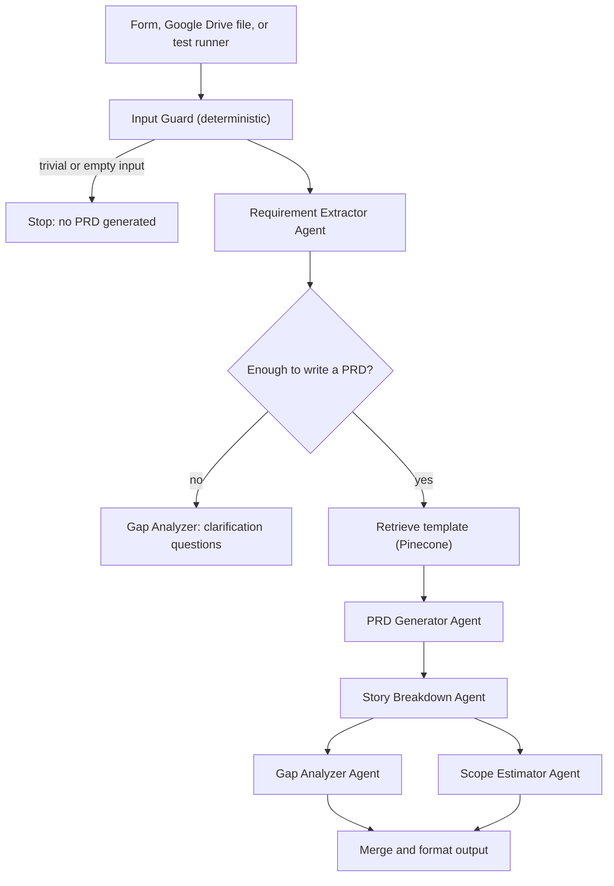

# Q3: Build PRD Genie

PRD Genie turns meeting transcripts, briefs, and stakeholder notes into a structured PRD, epics and user stories with priorities, clarification questions, and T-shirt estimates. It is built in n8n with Gemini, Pinecone, and Langfuse. Workflows, test results, and screenshots are in the repository.

## 1. Design

### Architecture and orchestration pattern

I chose a **Sequential Pipeline** with a parallel fan-out at the end. Every input needs the same stages in the same order (extract, generate, break down), so a Router would add branching with nothing to route, and a Hierarchical pattern would add decomposition that single documents do not need. Gap Analysis and Scope Estimation depend only on the stories and not on each other, so they run in parallel. Multiple files are handled outside the pipeline: the Drive Intake workflow loops over files and calls the same tested pipeline once per file.

### Agent decisions
Each agent has one job and a JSON contract with the next, so a failure can be traced to one stage. The Extractor runs at temperature 0 and must attach a verbatim `source_quote` to every requirement. That is the main anti-hallucination device, and it is what the grounding score measures. Contradictions and stakeholder disagreements are recorded, never resolved. Two deterministic steps sit around the agents: an Input Guard that stops trivial input before any model call, and a JSON parse-and-repair step after the Extractor that falls back to "insufficient" instead of producing a PRD from broken data.

### Tool rationale
| Need | Choice | Why |
|---|---|---|
| Orchestration | n8n | Visual canvas, sub-workflows, native Gemini, Pinecone, and Drive nodes, JSON export |
| LLM | Gemini 3.5 Flash Lite on all agents | Low cost; paid OpenAI credit was avoided and several newer models did not work in n8n at build time. The structured outputs it produces are good enough with the repair step. |
| Retrieval | Pinecone | The PRD template and a sample PRD give every PM the same format. **Retrieval supplies structure and style only; requirements come only from the input.** |
| Observability | Langfuse | Per-agent traces, token and cost data, and custom scores |

### Human-in-the-loop
The brief marks this optional. It is **designed but not built**: the natural place is an approval step between the Extractor and the PRD Generator. Today's human checkpoint is the gap analysis, where vague or contradictory input produces questions for stakeholders instead of a PRD.

## 2. Implementation

**Core capabilities (end to end).** The Extractor separates stated requirements, ambiguities, assumptions, and missing information. The PRD Generator writes a ten-section PRD. The Story Breakdown Agent produces epics, features, and "As a ..." stories with Must / Should / Nice to Have priorities and source requirement IDs. Input arrives from a form or from Google Drive: three files in the Inbox folder produced three PRD files in the Outputs folder, each containing the PRD, epics and stories, and gap analysis.

**Extended capabilities.** Both the **Gap Analyzer** (clarification questions, each grounded in a named gap, with a blocking flag) and the **Scope Estimator** (S/M/L/XL, flagging underspecified stories with the open question that causes it) are built, and run in parallel.

**Observability.** Each run produces one Langfuse trace with a generation per agent, plus two deterministic scores. `quote_grounding` is the share of extracted requirements whose quote appears in the input, which acts as a hallucination metric. `story_traceability` is the share of stories that cite a source requirement. Traces found two real problems: a malformed JSON string from the model that silently produced a blank PRD (fixed with the repair step and a safe fallback), and a score that reported 1.0 when there was nothing to check (changed to 0 on a broken run).

**Baseline dataset results.** All 12 tests (T1 to T12) pass in the final run. Each has automated checks for the brief's "must contain" and "must NOT" conditions, and full per-test output is in `test-results/`.

| Run | Change | Result |
|---|---|---|
| 1 | Baseline prompts | 9/12: T2 invented a requirement from a vague wish, T4 filed acceptance criteria as requirements, T6 missed a stakeholder tension |
| 2 | Extractor rules added | 11/12: T10 did not surface the unknown ETA as a risk |
| 3 | ETA rules in PRD and Gap Analyzer | 12/12 |
| 4 | Pinecone RAG added, with a template-leak check | 12/12 |
| Final | Model aligned across agents; gap prompt extended | 12/12. A model change made T2 fail one check, the suite caught it, and a prompt fix resolved it |

## 3. Cost and evaluation strategy

**Cost.** A full run is about five model calls and 5,000 to 6,000 tokens, which Langfuse reports at about **$0.005 per PRD** at list price. The ten-input test suite costs roughly five cents. Embeddings are a fraction of a cent. At 100 PRDs a day that is about $0.50 a day (an estimate from the per-run figure, before platform fees). Levers: inputs stopped by the guard cost nothing, insufficient inputs skip three of the five calls, and the cheapest model is used throughout.

**Evaluation strategy.** Four layers:
1. **Runtime guards:** the Input Guard, the sufficiency routing, and the parse fallback.
2. **Per-run scores in Langfuse:** grounding and traceability, to be reviewed whenever either drops below 1.0.
3. **Regression suite:** T1 to T12 run on every prompt or model change, as the T2 case showed.
4. **Human review:** several tests carry manual notes where an automated check cannot judge (neutral treatment of stakeholders, sensible priorities).

Next steps are an LLM-as-judge faithfulness check on the generated PRD, a held-out set of real transcripts, and tracking the JSON repair rate.

## 4. Limitations
Prompts were tuned on the same 12 tests, so 12/12 shows the baseline is met, not that the system generalizes. The checks are keyword and structure tests. The Drive path reuses the tested pipeline but is not in the automated suite. Only the Extractor has a JSON repair step. Latency is not captured in Langfuse. Langfuse's v3 ingestion API, which this project uses, stops accepting traces on 16 November 2026, and the migration path is the OpenTelemetry endpoint.
